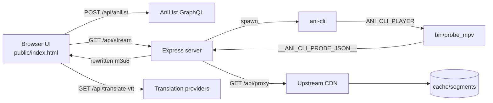

<div align="center">


**A self-hosted, Netflix-style web UI for [ani-cli](https://github.com/pystardust/ani-cli).**

[](https://nodejs.org)
[](https://expressjs.com)
[](https://github.com/video-dev/hls.js)
[](https://github.com/pystardust/ani-cli)
[](./package.json)

[](https://github.com/Neuxbane/ani-cli-ui/stargazers)
[](https://github.com/Neuxbane/ani-cli-ui/issues)
[](https://github.com/Neuxbane/ani-cli-ui/commits)

[**Quick Start**](#-quick-start) · [**Features**](#-features) · [**API**](#-api-reference) · [**How It Works**](#-how-it-works) · [**Troubleshooting**](#-troubleshooting)

</div>

---

> [!WARNING]
> **Disclaimer** — This project does not host or distribute any video content. It only automates a locally installed `ani-cli` and third-party public endpoints. You are responsible for complying with the laws and terms of service that apply to you.

---

## ✨ Features

<table>
<tr>
<td width="50%" valign="top">

### 🎬 Streaming
- **ani-cli stream resolution** — runs `ani-cli` with a probe player (`bin/probe_mpv`) to capture the stream URL, referer, and subtitle track.
- **Universal stream proxy** — `/api/proxy` forwards requests with the correct `Referer`, rewrites `.m3u8` playlists (variants, keys, init maps, segments), and retries transient CDN failures.
- **Disk-backed segment cache** — repeated HLS segments are served from `cache/segments` with size/age limits.

</td>
<td width="50%" valign="top">

### 🍿 Experience
- **AniList-powered browsing** — trending, search, and detail views via a server-side GraphQL proxy (avoids browser CORS/tracking blocks).
- **Player UX** — HLS.js playback, next/previous episode, episode sidebar, resume position, subtitle appearance settings, and keyboard shortcuts.
- **Local persistence** — watchlist, history, audio preference, subtitle language, and NSFW toggle stored in `localStorage`.

</td>
</tr>
<tr>
<td width="50%" valign="top">

### 💬 Subtitles
- **Auto-translation** — full WebVTT files are preprocessed and translated in the background (Google Translate endpoints with a MyMemory fallback), with in-memory caching.
- **Language picker** — Indonesian, Spanish, French, German, Portuguese, Russian, Italian, Japanese, Korean, Chinese (Simplified/Traditional), and more.

</td>
<td width="50%" valign="top">

### 🔞 Providers
- **18+ scrapers** — optional direct scrapers for `aki-h` and `watchhentai` when NSFW mode is enabled.
- **Auto fallback** — probes Aki-H first, then WatchHentai, and reports which provider served the stream.

</td>
</tr>
</table>

---

## 🧰 Requirements

| Dependency | Notes |
| :--- | :--- |
| **Node.js 18+** | Uses the built-in global `fetch` (tested on Node 26). |
| **`ani-cli`** | Must be on `PATH`. The bundled `bin/ani-cli` (v5.1.0) is used first if present. |
| **`curl`** | Required by `ani-cli`. `curl-impersonate` variants are used when available. |
| **`fzf`** (or `rofi`/`dmenu`) | `ani-cli` uses a menu program; `fzf` is the default. |
| **`mpv`** | Not required for the web UI — the probe script replaces it. |

---

## 🚀 Quick Start

```bash
# 1. Clone
git clone https://github.com/Neuxbane/ani-cli-ui.git
cd ani-cli-ui

# 2. Install dependencies
npm install

# 3. Verify ani-cli works on its own
ani-cli --version

# 4. Launch
npm start        # or: node main.js
```

<div align="center">

### 🌐 Open <http://localhost:3000>

</div>

The server logs the resolved stream URL and provider for each playback request — handy when debugging a failing source.

---

## ⌨️ Player Shortcuts

| Key | Action |
| :---: | :--- |
| <kbd>Space</kbd> | Play / pause |
| <kbd>←</kbd> / <kbd>→</kbd> | Seek −10s / +10s |
| <kbd>C</kbd> | Toggle subtitles |
| <kbd>E</kbd> | Toggle episode sidebar |
| <kbd>Shift</kbd>+<kbd>N</kbd> / <kbd>Shift</kbd>+<kbd>P</kbd> | Next / previous episode |
| <kbd>Esc</kbd> | Close sidebar, then player |

---

## ⚙️ Configuration

All configuration is via environment variables.

| Variable | Default | Description |
| :--- | :--- | :--- |
| `PORT` | `3000` | HTTP port for the server. |
| `PROXY_TIMEOUT_MS` | `20000` | Per-attempt timeout for upstream proxy requests. |
| `PROXY_RETRIES` | `3` | Retry attempts for retryable upstream statuses (403/404/408/425/429/5xx). |
| `SEGMENT_CACHE_DIR` | `./cache/segments` | Location of the disk segment cache. |
| `SEGMENT_CACHE_MAX_BYTES` | `8589934592` (8 GiB) | Maximum cache size before eviction. |
| `SEGMENT_CACHE_MAX_AGE_MS` | `259200000` (3 days) | Maximum age of cached segments. |

> [!NOTE]
> `ani-cli` also honors its own variables (for example `ANI_CLI_HIST_DIR` and `ANI_CLI_DOWNLOAD_DIR`), which are passed through.

---

## 🔌 API Reference

| Method | Endpoint | Description |
| :---: | :--- | :--- |
| `POST` | `/api/anilist` | Proxies a GraphQL request body to `https://graphql.anilist.co`. |
| `POST` | `/api/translate` | Translates `text` or an array of `texts` (`targetLang`, `sourceLang`). |
| `POST` | `/api/preprocess-subtitles` | Starts background translation of a VTT file and reports whether it is cached. |
| `GET` | `/api/translate-vtt` | Returns a translated WebVTT file (`url`, `target`, `source`, `referer`). |
| `GET` | `/api/proxy` | Proxies a stream/segment/subtitle URL (`url`, `referer`, optional `nocache=1`). |
| `GET` | `/api/stream` | Resolves a stream (`title`, `episode`, `dub`, `isAdult`, `provider`). |

<details>
<summary><b>📡 Example request &amp; response</b></summary>

<br />

```bash
curl "http://localhost:3000/api/stream?title=Frieren&episode=1&dub=false&isAdult=false"
```

```json
{
  "success": true,
  "url": "/api/proxy?url=https%3A%2F%2F...&referer=https%3A%2F%2F...",
  "rawUrl": "https://.../master.m3u8",
  "isHls": true,
  "subtitles": "/api/proxy?url=...",
  "title": "Frieren",
  "referer": "https://...",
  "provider": "ani-cli",
  "command": "ani-cli --no-detach --exit-after-play  -e 1 -S 1 \"Frieren\""
}
```

</details>

---

## 🧠 How It Works



1. The frontend requests `/api/stream` with a title and episode.
2. The server runs `ani-cli --no-detach --exit-after-play -e <ep> -S 1 "<title>"` with `ANI_CLI_PLAYER` pointed at `bin/probe_mpv`.
3. `probe_mpv` prints a `__ANI_CLI_PROBE_JSON__` line containing the stream URL, referer, subtitle URL, and title; the server parses it (with a regex fallback).
4. The stream URL is returned as a `/api/proxy` URL. The proxy forwards the `Referer`, rewrites HLS playlists, caches segments, and retries flaky CDN responses.
5. Subtitles are fetched through the proxy and translated on demand or in the background.

---

## 📁 Project Structure

```text
ani-cli-ui/
├── main.js                  Express server, API routes, proxy, translation
├── lib/
│   └── segmentCache.js      Disk-backed HLS segment cache
├── providers/
│   ├── akih.js              Aki-H (18+) scraper
│   └── watchhentai.js       WatchHentai (18+) scraper
├── bin/
│   ├── ani-cli              Bundled ani-cli (v5.1.0)
│   └── probe_mpv            Fake player that captures ani-cli stream parameters
├── public/
│   ├── index.html           Single-page frontend
│   └── vendor/              Vendored hls.js and Tailwind (CDN fallback)
└── cache/
    └── segments/            Runtime segment cache (gitignored)
```

---

## 🩺 Troubleshooting

<details>
<summary><b><code>Program curl not found</code> / <code>Blocked by cloudflare</code></b></summary>

Install `curl` (and ideally `curl-impersonate`) so `ani-cli` can reach the source.
</details>

<details>
<summary><b><code>No sources found</code> / 404 from <code>/api/stream</code></b></summary>

The upstream source may be down or the title may not match. Try the exact title from AniList, or run the `command` returned in the error response manually.
</details>

<details>
<summary><b>Playback stalls or 403s</b></summary>

Increase `PROXY_RETRIES` / `PROXY_TIMEOUT_MS`, or clear `cache/segments` if a stale segment was cached.
</details>

<details>
<summary><b>Subtitles not translating</b></summary>

Translation relies on public endpoints that may rate-limit; results are cached in memory and reset on restart.
</details>

<details>
<summary><b>Disk usage growing</b></summary>

Lower `SEGMENT_CACHE_MAX_BYTES` or delete `cache/segments`.
</details>

---

## 📜 License

ISC (see `package.json`). The bundled `bin/ani-cli` is from [pystardust/ani-cli](https://github.com/pystardust/ani-cli) and is licensed under GPL-3.0.

<div align="center">


<sub>Built with ☕ and <a href="https://github.com/pystardust/ani-cli">ani-cli</a> · Not affiliated with any streaming service.</sub>

</div>
